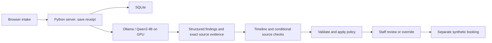

# CareRoute: three-minute demo

Double-click **Start Final Demo.cmd** and use **http://127.0.0.1:8081/**. Keep the app terminal open, the laptop awake and plugged in. Port 8080 may still contain an older running copy.

On this laptop, press **Win + R** and paste:

```text
"C:\Users\ludic\Documents\Codex\2026-10-25\can\outputs\ai-hack\Start Final Demo.cmd"
```

The launcher starts the Python server and, if needed, the installed local Ollama runtime. SQLite is built in; there is no separate database service. The browser runs the frontend. Each request triggers inference; no continuous background reasoning job is needed.

Before presenting, run this from the repository to check the app and warm the model:

```powershell
python -X utf8 tools/demo_status.py --warm-up
```

This creates one invented routine request, verifies fresh inference, and reports model GPU memory. Omit `--warm-up` for a read-only readiness check. The model can unload after inactivity; submit a routine example shortly before judging to avoid the cold-load delay. Do not run evaluation suites during the presentation, because they compete for the GPU.

## Timed speaking script

| Time | Click or show | Say |
|---|---|---|
| 0:00–0:20 | Intake page | “Clinics receive free-text requests that staff must interpret. CareRoute creates a traceable administrative handoff: routine appointment, same-day human review, or emergency guidance. We use invented records and keep staff in control.” |
| 0:20–1:00 | **Routine visit → Review with AI → Source excerpts** | “The example fills the form; it does not replay an answer. Qwen3 4B reads this request locally on the RTX 4060. These are its exact source excerpts, actual model name, elapsed time and output-token count.” |
| 1:00–1:50 | **Continue to staff review**; sign in, match the receipt ID, review and book | “Staff compare the original text, structured findings and recorded rules. They can confirm or override with a reason. The AI result alone cannot book an appointment.” |
| 1:50–2:10 | **Complete immutable audit history** | “The audit retains the model response, verification steps, rule decision, human review and booking. These are observable structured outputs and evidence.” |
| 2:10–2:40 | **New request → Needs attention → Review with AI**; then **Immediate concern** without submitting | “A different narrative produces a different handoff. Clear emergency indications display guidance before saving or waiting for AI. Failed or unclear inference goes to human review.” |
| 2:40–3:00 | State the result | “Our final local pipeline matched all 36 disclosed synthetic regression cases, including the checked fields. This measures agreement with our policy labels; clinical performance on real patients remains unvalidated.” |

Use the tested example text unchanged for the timed walkthrough. Judge-requested edits are optional exploration with fresh inference. If an output is unexpected, show the saved original text and staff-review path honestly.

## 1. Show a real local model

Point to the model panel: it reports the installed model and connection to Ollama. Explain: "The request is read on this laptop. There is no cloud model or API key in this flow."

Click **Routine visit**, scroll down and click **Review with AI**. The scenario button fills invented inputs; it does not load a saved AI answer. The receipt appears first, then **AI handoff / Live inference**. Expand **Source excerpts** and show the model name, token count and measured duration.

## 2. Complete the staff workflow

Click **Continue to staff review**. Sign in with `reviewer` / `demo-reviewer`, then **Open staff workspace**. Select the request matching the receipt's short ID; an older emergency can sort above it. Compare the original description, AI-selected excerpts and six structured assessments.

Keep **Administrative action → Routine appointment** and choose **Reason → Other / confirm suggestion**. Enter “Reviewed the invented original text and source excerpts; confirmed the demo route.” Click **Save review**, choose a future time and **Confirm synthetic booking**. Open **Complete immutable audit history** to show the actual request, raw model output, policy decision, review and booking events.

The model proposes a handoff; a human completes the booking. No external appointment or notification is created.

## 3. Show a different outcome

Return through **New request**. Choose **Needs attention → Review with AI** to show same-day human review. Then choose **Immediate concern** to show guidance immediately, before submission or AI inference; do not submit merely to demonstrate that immediate notice.

If time permits, **Different wording → Review with AI** demonstrates interpreting negation, rather than treating every warning keyword as a current emergency. Show the original text alongside the suggestion.

## 4. Explain failure honestly

The test suite also exercises a disconnected model. CareRoute retains the saved request, labels the AI as unavailable and sends it for staff review. It never substitutes a canned success. The default no-AI baseline, available in advanced controls, demonstrates the difference: ordinary narratives remain unassessed and go to human review.

## Useful answers for judges

- **What is AI here?** A pretrained local Qwen3 4B Instruct model interprets the narrative, returns structured assessments, selects exact evidence excerpts, and checks timeline consistency. Conditional source attribution helps distinguish an actual warning from quoted fictional material. There is no fine-tuning in this prototype.
- **What is deterministic?** Input validation, immediate warning checks, routing precedence, excerpt validation, persistence, permissions and booking transitions.
- **Why local?** No hosted inference cost or key is needed for the demo; inputs stay on the laptop in local mode.
- **Can it handle real patients?** This demonstration uses invented records and an illustrative policy. Clinical validation, approved scope, real authentication and operational integration are outside this submission.
- **How is it tested?** 150 automated tests, 12 browser regression checks and 7 live-model browser checks. Keep these engineering counts separate from model accuracy.
- **Where did the dataset come from?** The supplied assignment asks for synthetic records and test cases; it gives no dataset or numerical accuracy target. Our examples and labels were assistant-authored against our declared policy. They are not organizer data or clinician-validated ground truth.
- **Is it 100% accurate?** Say: “We achieved 100% policy-label agreement on 36 disclosed synthetic regression cases: 28 challenge cases plus 8 timing cases. All produced valid outputs and passed the selected semantic checks. This is a development result; performance on arbitrary new input is not guaranteed.”
- **What happened on unseen cases?** The earlier frozen runs scored 27/28 routes (96.4%) and 6/8 routes (75%). Failures are preserved. The later 36/36 follows fixes informed by those cases and is not a new unseen benchmark. The first 28-case run had 26 valid outputs and 23 strict matches; route agreement alone includes fallback outcomes.
- **What about the other 38 cases?** The broad v11 live run matched 38/38 comparable routes. V12 preserves these outcomes when replaying captured responses with identical model-request payloads. That replay made zero new model calls; do not count it as a fresh v12 benchmark.

## Explain the full pipeline in 30 seconds

“The browser saves the invented request to a local Python server and SQLite before inference. Qwen reads the narrative and returns constrained assessments with source IDs. Another model call checks timing consistency; conditional checks distinguish actual concerns from fictional quotations. Code maps the source IDs to exact original excerpts, validates the response, and applies our routing policy. Fixed age and scope facts are calculated by code. Staff review or override the suggestion before any synthetic booking.”



The six displayed fields are current warning, request intent, information sufficiency, conflicting details, demo scope and additional review. The model interprets language; code enforces scope facts, validation, immediate checks, routing precedence and permissions. The staff panel and audit show structured outputs and evidence, not hidden chain-of-thought. A typical assessment makes two model calls, with additional source checks only when needed. A validated primary warning survives a later verifier failure, visibly marked incomplete.

## Connect it to the problem statement

| Requirement | Evidence to show |
|---|---|
| Intake with description, urgency and preferences | Editable intake form |
| Team-defined administrative routes | Three categories and matched policy rules |
| AI-assisted interpretation | Fresh inference, semantic fields and source excerpts |
| Reasons and staff override | Original text, explanations, review reason and audit |
| Unclear/high-risk fallback | Human review and immediate emergency guidance |
| Avoid automated diagnosis | Bounded administrative labels and original excerpts |
| Synthetic records, tests and safety note | Invented examples, preserved evaluations and report |

No real booking or notification is sent. An emergency downgrade requires a different supervisor; leave that longer path out of the timed demo.

Evidence: [current report](reports/submission-report.md), [final 28-case result](reports/generated/challenge-regression-results.json), [final 8-case result](reports/generated/fresh-temporal-regression-results.json), [original assignment](docs/00-original-assignment.md), and [GitHub commits](https://github.com/divyamagrawal06/ai-hack/commits/main/).
