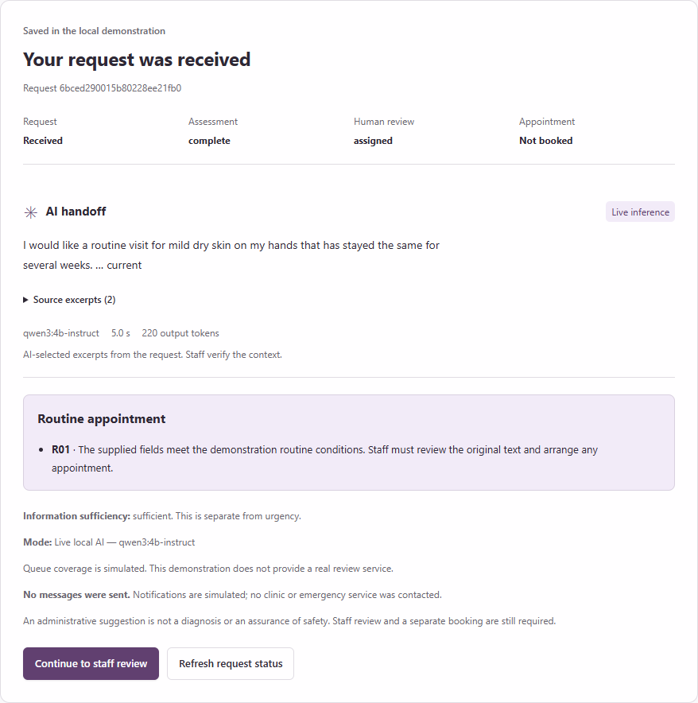

# CareRoute

**Local AI intake. A clearer handoff to staff.**

CareRoute turns an invented clinic appointment request into a structured, reviewable handoff. A real **Qwen3 4B Instruct** model runs on your computer through Ollama. It reads the description, assesses six routing factors and selects exact source excerpts for staff. Versioned rules combine those assessments with the form answers; a person reviews and confirms any synthetic booking.



This is a hackathon prototype for invented records, not a clinical service. It does not diagnose, prescribe, contact emergency services or make real appointments.

## Start on this computer

Double-click **Start CareRoute.cmd**, or run:

```powershell
python -X utf8 tools/start_demo.py
```

Open **http://127.0.0.1:8080**. The launcher starts the portable local runtime if needed. The model panel shows actual connectivity; a successful result displays its model, inference duration, token count and source excerpts.

If an earlier copy is still running on port 8080, double-click **Start Final Demo.cmd**. It starts the updated code with a separate demo database at **http://127.0.0.1:8081**, without stopping the older instance.

1. Click **Routine visit** to load an invented request. You can edit it.
2. Click **Analyze request**. The example is assessed afresh by local AI.
3. Open **Staff workspace**, sign in, inspect the AI handoff and original text, save a review, then confirm a synthetic appointment.

| Demo account | Password | Role |
|---|---|---|
| reviewer | demo-reviewer | Review, override and book |
| supervisor | demo-supervisor | Approve another reviewer's emergency downgrade |

These are public demo credentials. Only the loopback address is served.

## Set up a fresh Windows machine

Requires Python 3.11+ and an up-to-date GPU driver. The Python app has no third-party runtime dependencies. The setup downloads the official portable Ollama runtime and approximately 2.5 GB of model weights:

```powershell
powershell -ExecutionPolicy Bypass -File tools/install_local_ai.ps1
python -X utf8 tools/start_demo.py
```

If you already use Ollama on Windows, macOS or Linux, run `ollama pull qwen3:4b-instruct` and `ollama serve`, then start the app. The portable Windows setup uses Vulkan. An 8 GB RTX 4060 is the target demo hardware; CPU inference is possible but slower.

## What the AI actually does

The local model produces six constrained assessments: current warning, request intent, information sufficiency, conflicting statements, supported demo scope and additional human-review need. It also selects source excerpts. The application verifies every excerpt against its declared input field and rejects invalid responses. No generated diagnosis or reassurance is displayed.

A focused second model call compares the narrative's timeline with the structured onset answer. It selects source IDs mapped to exact input text, with each excerpt identifying its source field. The application reconciles known scope and missing-information facts from the form. When the model is the only emergency trigger, an additional source-attribution check separates actual concerns from explicitly fictional material. If both kinds are present, a fresh assessment of the attributed actual text can send the ambiguous request to human review. Independent form/text emergency checks always retain precedence. This is a real inference pipeline; no fixture ID selects a canned answer.

The full prompts, model identity/digest, raw responses, parsed assessments, verification steps, timing, total token usage and input revision are retained for staff audit. The default path uses **fresh local inference**; example buttons only fill the form. No API key, hosted model or paid service is needed.

Immediate form checks operate before saving or inference. A model outage, timeout or invalid output produces a visible staff-review fallback. Saved requests, assessments, human reviews and bookings are distinct states. SQLite preserves the workflow across restarts. Changes are version checked; late AI cannot overwrite a completed human review.

If the primary model has already produced a validated current warning and a later verification step fails, the partial result retains emergency guidance. It is visibly marked incomplete and cannot qualify a request for routine handling.

## Configuration

| Setting | Default / purpose |
|---|---|
| `CLINIC_LOCAL_MODEL` | `qwen3:4b-instruct` |
| `CLINIC_OLLAMA_URL` | `http://127.0.0.1:11434`; loopback addresses only |
| `OLLAMA_EXE` | Optional path to a portable Ollama executable |
| `OLLAMA_MODELS` | Optional model storage override for the launcher |
| `--port 8081` | Use another app port |
| `--db var/demo.sqlite3` | Choose a local database |
| `--no-browser` | Start without opening a browser |

The advanced mode selector retains no-AI baseline, clearly labelled authored replay, and optional Jev/OpenAI adapters from the original prototype. Those cloud adapters need explicit environment credentials and are not used by the default local flow. They are not part of the local-model validation.

## Verify and package

```powershell
python -X utf8 tools/run_checks.py
python -X utf8 tools/evaluate.py
python -X utf8 tools/validate_spec.py
python -X utf8 tools/browser_check.py
python -X utf8 tools/browser_live_check.py
python -X utf8 tools/evaluate_live.py --execute --arms local_ai
python -X utf8 tools/probe_local_ai.py --execute
python -X utf8 tools/evaluate_challenge_regression.py
python -X utf8 tools/build_submission.py
```

Browser checks require `python -m pip install -r requirements-dev.txt`. They use installed Chrome/Edge/Chromium, or a Playwright Chromium installation. `browser_live_check.py` and `evaluate_live.py --execute` require the actual local model; they do not substitute authored responses.

The challenge regression command above only validates the frozen data and unchanged labels. To repeat actual inference on the now-disclosed challenge:

```powershell
python -X utf8 tools/evaluate_challenge_regression.py --execute --policy-change-note "Policy 0.4 retains validated warnings after verification failure. Labels are unchanged."
python -X utf8 tools/evaluate_challenge_regression.py --execute --dataset fixtures/fresh-temporal-v1.json --freeze fixtures/fresh-temporal-v1.freeze.json --first-blind reports/generated/fresh-temporal-results.json --output-prefix fresh-temporal-regression
```

Every retest is archived separately. The original blind result is preserved, and the original blind runner refuses changes to its frozen policy. Rerunning disclosed examples cannot create a new held-out accuracy claim.

The package is `dist/careroute-submission.zip`, with a verified SHA-256 manifest. Databases, downloaded binaries, model weights, secrets and Git metadata are excluded; the setup script recreates the runtime.

## Submission material

- **Original development suite:** the latest broad live run (v11) matched 38/38 comparable cases with 43/43 valid assessments. The final v12 adapter also matches all 38 when replaying those captured responses, with every model-request payload verified identical. That regression uses zero new model calls; it is not a fresh v12 measurement.
- **Final live challenge retest:** v12 matches all 28/28 routes with 28/28 valid assessments and all selected semantic-field checks passing. These are disclosed development cases with unchanged labels.
- **Original blind result:** the earlier v5 pipeline scored 27/28 routes (96.4%). That record is preserved. The current 28/28 retest follows fixes informed by those cases, so it is development evidence rather than a new blind score.
- **Fresh temporal result:** the first frozen v7 run scored 6/8. Both failed cases fell back to human review after evidence-contract errors. This original result is preserved separately from any subsequent disclosed retest.
- **Final live temporal retest:** v12 matches all 8/8 routes with 8/8 valid assessments and all selected semantic-field checks passing. These cases are now disclosed development material; the original 6/8 score remains unchanged.
- **Application checks:** 150 automated tests pass; browser and real-inference workflow evidence are included in the current report.

- [Original assignment and dataset scope](docs/00-original-assignment.md)
- [Demo walkthrough](DEMO.md)
- [Current submission report](reports/submission-report.md), [printable PDF](reports/submission-report.pdf), [HTML](reports/submission-report.html)
- [Recorded checks](reports/generated/test-results.json) and [browser checks](reports/generated/browser-results.json)
- [Implementation notes](reports/implementation.md) and [original research](research/jev-evidence.md)
- [Original pre-local-AI report](reports/iterations/pre-local-ai-submission.md)

The seven documents in `docs/` are labelled original design snapshots. Fixtures are visible, invented development examples. Their agreement scores are engineering evidence, not clinical validation or held-out model accuracy.
