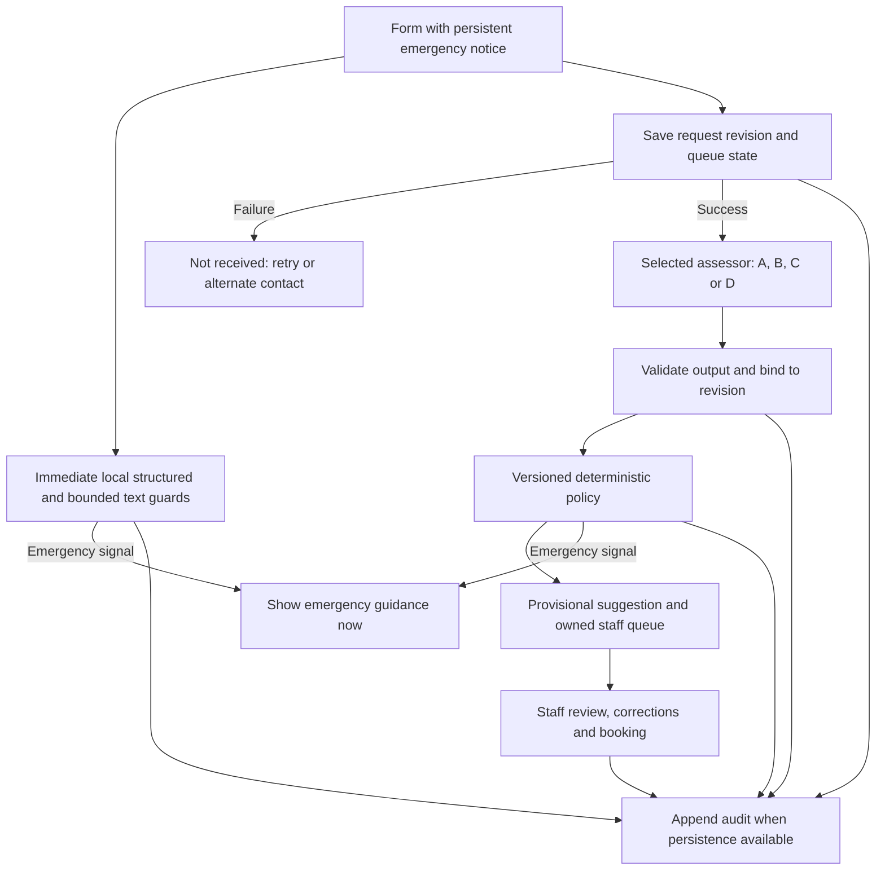

# 02 — Research and architecture decisions

> **Design snapshot (policy 0.1).** This document preserves the original requirements and proposed contracts. The runnable policy 0.3 implementation, executed checks, research updates and explicit deviations are described in [the submission report](../reports/submission-report.md) and [implementation notes](../reports/implementation.md). Statements below about unstarted work or blocked reading describe the earlier specification stage.

## Evidence status and reading record

The requested full-text papers could not be read: the environment's HTTPS proxy rejected their hosts with CONNECT 403, including after a network-permission retry. This is an access failure, not evidence that the citations are invalid. The [Jev evidence review](../research/jev-evidence.md) and [workflow evidence review](../research/workflow-evidence.md) record exact URLs, attempted alternatives, sections still to extract, and the distinction between supplied summaries and verified evidence. Do not describe this package as a completed literature review.

What was read: the official TypeSafe Python SDK generated API schemas, answer parsing, defaults/client behavior, package metadata, vendor question-design guidance, TypeSafe WorkflowEvals methods/scoring, and CARE-Bench companion documentation/scoring at pinned Git commits. These establish interfaces and reported research methods, but not independent clinical performance. No model was called. No SDK or benchmark behavior was experimentally tested.

| Source family | Evidence actually available | Consequence and limitation |
|---|---|---|
| Official TypeSafe SDK and guidance ([J6–J11](../research/jev-evidence.md)) | `Choice` exposes selected label, probabilities and confidence; `Noul` exposes probability of yes; `Score` returns a probability-weighted rubric score. Questions in a request do not see one another's answers. | Direct routing with defer is technically plausible. Decomposition requires application composition. API shape does not establish good routing. |
| Official confidence guidance ([J9](../research/jev-evidence.md)) | Confidence measures distribution concentration. The wrapper package drops probabilities; the lower-level SDK exposes them. | Preserve native outputs; do not treat confidence as probability of clinical safety. Calibrate against independently assigned local policy labels. |
| Official schemas and parser ([J6–J8](../research/jev-evidence.md)) | Several floats lack enforced range bounds; unknown answer types can be omitted by response processing. No arbitrary text explanation/evidence-span primitive is supplied for the read text interfaces. | Enforce exact output contracts, missing questions, finite ranges and known IDs in the application. Retain raw output. Generate explanations from input and rule events. |
| Native Probability Outputs for Clinical Triage; Jev in Medicine; Controlled Audit of Self-Knowledge | User-supplied summaries only; methods/results/limitations not independently read. | Investigate probability error versus routing error, sufficiency/clarification tradeoffs and missing-evidence judgments. These are hypotheses to verify, not grounds for choosing Jev. |
| CARE-Bench companion repository ([methods review](../research/workflow-evidence.md)) | Read task, construction/release description, direct-label interface and scorer. Reports 500 cases/1,059 disclosure prefixes, source reconstruction with model assistance and human review; urgent/emergency share one class. | Direct labels are supported without a generative output mapper. Keep emergency and same-day separate here. Its ordered insufficiency class is unsuitable for our independent sufficiency axis. Public code does not expose all reviewer records or validate clinical safety. |
| TypeSafe WorkflowEvals ([methodology review](../research/jev-evidence.md)) | Read four nonmedical workflow descriptions and scoring/contracts. Uses reference-model/consensus agreement, assumes workflow code is correct, and records coverage and failures. | Useful provenance methods; reference agreement is not clinical truth. Test workflow failures ourselves. Disclose batching differences: provider defaults group Jev questions but separate LLM questions. |
| Public-use randomized study; DECIDE-AI; FUTURE-AI | User-supplied leads only; study text/checklists not read. | Proposed human-workflow and lifecycle tests are justified as design needs here. Do not claim compliance with unread checklists or quote unverified trial results. |

For every paper, the pending extraction must capture bibliographic identity/version, study design, population/data origin, sample sizes, labels, annotation, models/prompts, comparators, primary outcomes, uncertainty, subgroup analysis, missingness, external validation, funding/vendor involvement and stated limitations. Record the exact section/table for each factual claim. Negative results and workload costs belong in the evidence table. A diagnostic benchmark and a clinical workflow study answer different questions from administrative appointment routing.

## Candidate architectures and fair test

| Candidate | What makes the suggestion | Why investigate | Principal unresolved risks |
|---|---|---|---|
| A: Structured form + staff, no AI | Structured policy guards and provisional form eligibility; staff interpret free text. | Establishes the simplest functional comparator and actual staff effort. | Unrecognized free-text warning, mismatch between text/checkboxes, staff availability and delay. |
| B: Direct Jev + defer | A finite `Choice`: routine, same-day, emergency or defer, subject to common guards. | Matches a decision model directly to the administrative choice; fewer intermediate decisions/calls may reduce failure and cost. | Hidden policy noncompliance, poor deferral, ambiguity and limited explanations. |
| C: Decomposed Jev + rules | Bounded current-warning, intent, sufficiency, contradiction and scope judgments feed versioned rules. | Each policy input is inspectable; supports targeted error analysis and staff correction. | Correlated component errors, extra clarification/escalation, increased calls/latency and harder question design. |
| D: Structured-output LLM + same rules | Equivalent bounded judgments using the same inputs and policy. | Tests whether broader contextual capabilities improve this bounded task. | Invalid schema, hallucinated support, prompt injection, latency/cost, and overconfident output. |

The comparison must preserve an actual direct-routing arm. Do not force B to pass through all of C's judgments and then call it “direct.” Required form completeness and structured emergency guards are shared application checks; a separate model-sufficiency question is a prespecified B ablation, not mandatory hidden decomposition. B's defer criterion must explicitly cover missing information, unclear currentness, contradictory text and unsupported scope. Application-known missing data still overrides any routine label.

All arms use the same emergency checks, operational fallback and staff workflow. Score raw suggestions and safeguarded final actions separately. Compare at matched information, case families, coverage/reviewer capacity and locked thresholds. Vendor differences in probability interfaces are disclosed; do not invent probabilities from LLM verbal confidence or treat sampling frequencies as equivalent native probabilities. Neither better calibration nor attractive examples prove superior routing.

## Proposed processing boundary

Receipt creates a pending review task before model work. A model can improve the suggested route; it cannot be a prerequisite for queue ownership or emergency guidance. Original input, normalized representation, assessment and final action remain distinct. A newly detected model emergency is displayed immediately on receipt of that signal, while recognizing that text-only recognition may already have been delayed; the evaluation must measure that limitation.

## Decision log

| ADR | Decision | Basis | Revisit when |
|---|---|---|---|
| ADR-01 | Keep immediate emergency guidance independent of AI, persistence and review. | Explicit assignment requirement; network-dependent safety is incompatible with it. | Policy wording/contact configuration changes; dependency must remain absent. |
| ADR-02 | Start detailed contract design around C, retain A/B/D as equal evaluation candidates. | Verified bounded interfaces fit the proposed inputs and audit structure. No empirical winner established. | Comparative results or interface limitations favor another candidate. |
| ADR-03 | Use finite judgments and deterministic composition; no medical explanation generation. | Actual rule execution is auditable; diagnoses are outside scope. | Team policy changes; explanations still require provenance. |
| ADR-04 | Keep sufficiency independent and treat defer/error as review. | Missing information cannot license routine; assess burden of conservative fallback. | Approved policy provides different operational action. |
| ADR-05 | Keep original text and revision-bound sentence IDs; evidence selection is optional and validated. | Jev text primitives lack arbitrary spans/prose. Valid IDs establish location, not logical support. | A verified API changes; must rerun fidelity tests. |
| ADR-06 | Record probabilities but set no clinical probability thresholds now. | Vendor confidence is concentration; local error thresholds are unknown. | Independent reference labels and team-approved risk/capacity bounds exist. |
| ADR-07 | Avoid dependencies or live model keys at specification stage. | Documents and synthetic fixtures can be reviewed without an application. | Implementation/experiments are explicitly started. |

The safest-looking conservative system can still cause harm through overwhelming reviewers or making help inaccessible. Report unnecessary emergency guidance and same-day review separately, track time-to-review and queue capacity, and evaluate user understanding. Preserve all failures in denominators. The [evaluation plan](06-evaluation-test-plan.md) specifies the proposed experiments; none have run.
